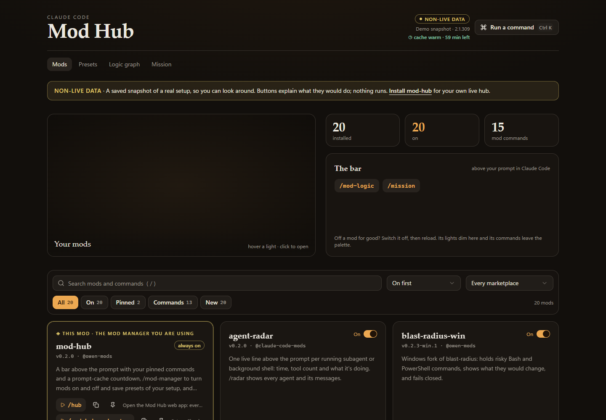
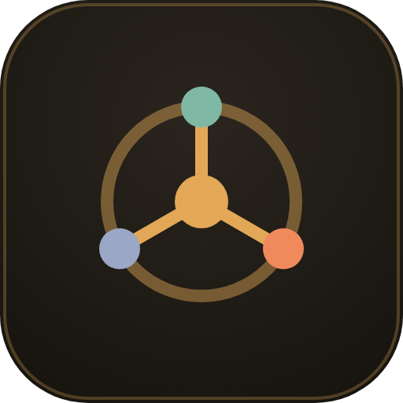
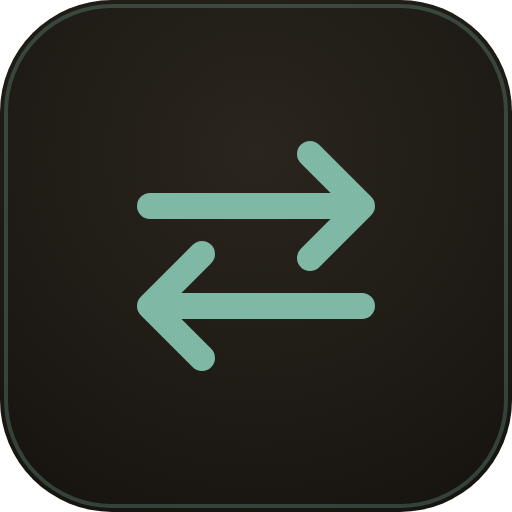
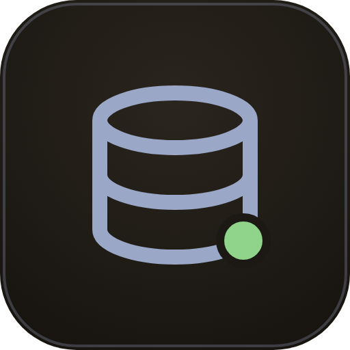
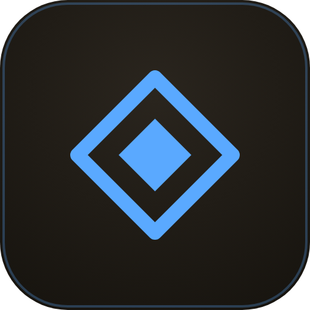
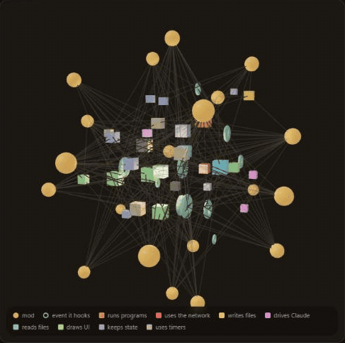
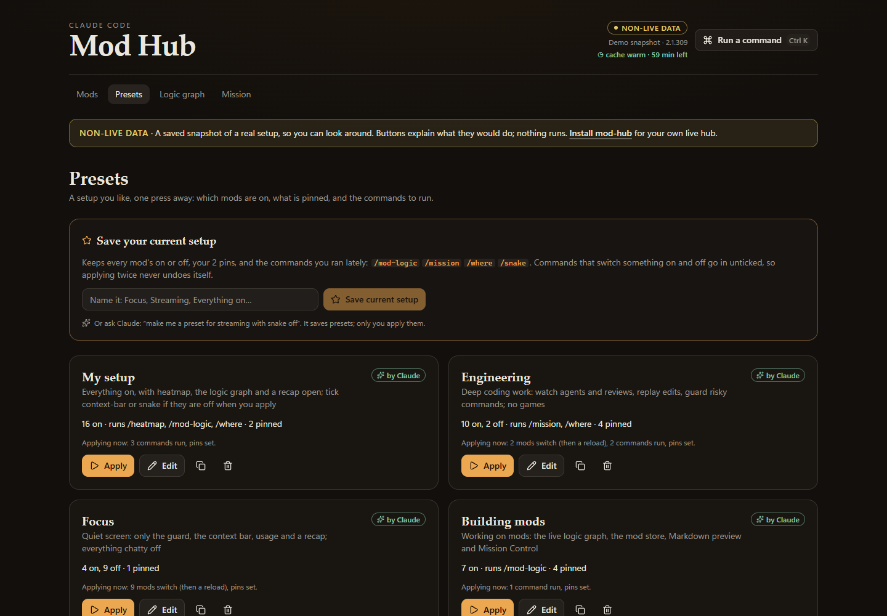
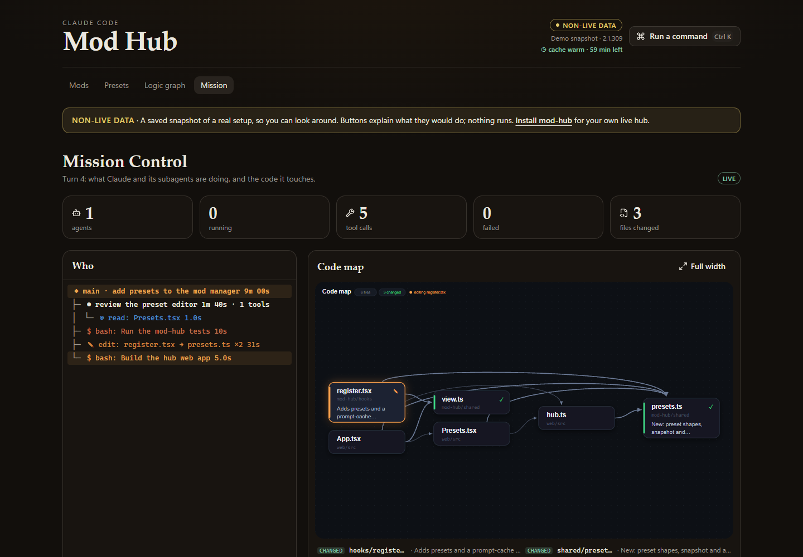

# claude-mods

[](https://github.com/THEROCKSSS/claude-mods/actions/workflows/ci.yml)
[](https://therocksss.github.io/claude-mods/)
[](https://github.com/THEROCKSSS/claude-mods/releases)
[](LICENSE)

Mods for [Claude Code](https://claude.com/claude-code):
- a manager for all your mods, with a live web hub
- a live graph of how every mod works
- watchers for your ports, your agent memory and mod updates

Built and tested on Windows. mod-hub, mod-logic, port-watch, memory-status and mod-updates have macOS and Linux code paths, and CI validates every mod on Ubuntu, but their test suites only run on Windows so far. Reports from other systems are welcome.

**[Try the hub in your browser →](https://therocksss.github.io/claude-mods/)** It is a saved snapshot (NON-LIVE DATA), so nothing runs.



## The mods

| | Mod | What it does |
| --- | --- | --- |
|  | **[mod-hub](mods/mod-hub)** | A bar above the prompt with your pinned commands and a **prompt-cache countdown**. `/mod-manager` turns mods on and off, runs or copies their commands, and saves **presets** of your setup. Claude can make presets for you; only you can apply them. `/hub` opens a web control room. |
|  | **[mod-logic](mods/mod-logic)** | `/mod-logic` shows how every mod works: the events it hooks, the capabilities it calls (coloured by risk) and what it registers. It is a 2D map in the pane and 2D or 3D in the hub, and it redraws as you edit a mod. |
|  | **[port-watch](mods/port-watch)** | `/ports` lists every listening port, the project or container that owns it, and whether your phone can reach it, with its Tailscale URL and a QR code. |
|  | **[memory-status](mods/memory-status)** | Whether your self-hosted Supabase memory is up or degraded, and how many writes are queued. It shows each container and one targeted fix. |
|  | **[mod-updates](mods/mod-updates)** | Spots new versions of your installed mods and shows the commits since your install. Update one or all in a click. |
|  | **[blast-radius-win](mods/blast-radius-win)** | Windows fork of [hamzafer's blast-radius](https://github.com/hamzafer/claude-code-mods). It holds risky Bash **and PowerShell** commands, shows what they would change, and fails closed. |
|  | **[mission-control-win](mods/mission-control-win)** | Windows fork of hamzafer's mission-control. A live map of agents and tool calls and a readable code map, full size in the hub. |

<table><tr>
<td></td>
<td><br></td>
</tr></table>

## Install

You need Claude Code with mods (2.1.29x or later). The web hub also needs Node 18+.

```bash
claude plugin marketplace add THEROCKSSS/claude-mods
claude plugin install mod-hub@owen-mods
claude plugin install mod-logic@owen-mods
claude plugin install port-watch@owen-mods
claude plugin install mod-updates@owen-mods
```

Then run `/reload-plugins` in Claude Code. Install `memory-status@owen-mods` only if you keep agent memory in a self-hosted Supabase.

Or ask your agent: *"install mod-hub from THEROCKSSS/claude-mods and set it up"*. mod-hub ships a `mod-setup` skill that walks it through installing, checking, and adding future mods.

On macOS or Linux, use hamzafer's original blast-radius and mission-control instead of the `-win` forks.

## Updating

mod-updates tells you when there is something new. After `claude plugin update` and `/reload-plugins`, mod-hub handles the rest:
- a hub left running from an older version is shut down and replaced
- mod-logic re-sends its graph to any hub that has not had it yet

## How the hub stays safe

The web page never runs anything. It queues a request, and the mod checks it against what this session actually has installed before running it.

The server:
- listens on `127.0.0.1` only
- needs a token on every API call, which only the served page knows
- refuses foreign `Host` and `Origin` headers, so another website can't drive it, even through DNS rebinding

See [SECURITY.md](SECURITY.md).

## Why the Windows forks exist

Upstream was written on macOS, and on Windows two things break quietly:

- **blast-radius failed open.** Its hold loop runs `sleep`, which isn't on Windows' PATH. The call throws, a hook that throws with no `.catch` is skipped, and the risky command runs unchecked. The fork:
  - waits on `$.clock.sleep`
  - previews through Git Bash
  - guards PowerShell too
  - fails closed
- **mission-control's code map needed Chrome at a macOS path,** and only drew in a terminal. The fork draws it with the desktop app's own `Svg` element.

## Develop

Each mod lives in `mods/<name>/`. See [CONTRIBUTING.md](CONTRIBUTING.md); agents should start from [AGENTS.md](AGENTS.md).

```bash
node scripts/check-mods.mjs                       # validate + test every mod
node --test mods/mod-hub/server/hub.test.mjs
cd mods/mod-hub/web && npm ci && npm run build    # writes mods/mod-hub/app
```

| Suite | Result |
| --- | --- |
| blast-radius-win | 20/20 |
| mod-hub | 16/16 |
| hub server | 11/11 |
| mod-logic | 5/5 |
| memory-status | 4/4 |
| port-watch | 4/4 |
| mod-updates | 2/2 |
| mission-control-win | 8/10. The same 2 tests fail on unmodified upstream with this engine (terminal PNG path, band order). |

## License

MIT. The forks keep Hamza Zafar's copyright; see [LICENSE](LICENSE) and [THIRD_PARTY_NOTICES.md](THIRD_PARTY_NOTICES.md).
