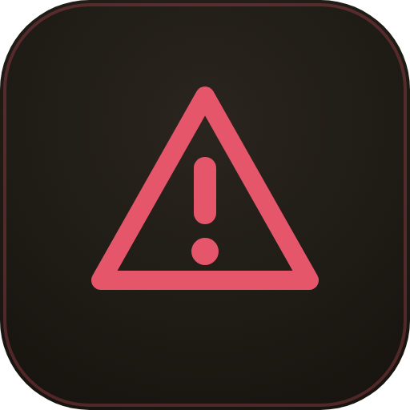

# blast-radius-win

A Windows fork of [hamzafer's blast-radius](https://github.com/hamzafer/claude-code-mods). It holds risky commands before they run, shows what they would change, and waits for Cancel or Proceed. The risky commands are:
- recursive deletes
- force pushes
- database migrations

## Why a fork

On Windows, upstream failed open. Its hold loop called `sleep`, which is not on Windows' PATH. The call threw, and a hook that throws with no `.catch` is skipped, so the risky command ran unchecked.

This fork:
- waits on `$.clock.sleep`
- previews through Git Bash
- guards the **PowerShell** tool as well as Bash (`Remove-Item -Recurse`, `rmdir` and the rest)
- **fails closed:** if the guard itself errors, the command is blocked

In a session with no screen to ask on (the desktop app, for now), it refuses the command and says what it would have done.

## Settings

| Setting | Default | |
| --- | --- | --- |
| `timeoutSeconds` | `60` | How long a held command waits before it is cancelled. `0` waits forever. |

MIT. Upstream's copyright is kept in [LICENSE](../../LICENSE). On macOS or Linux, use the original.
